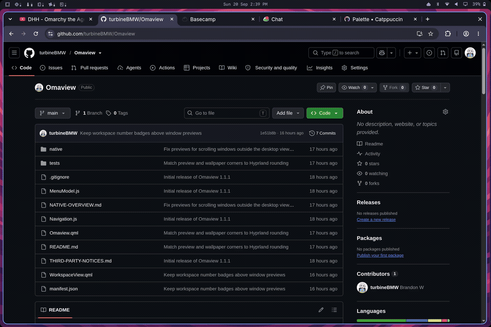
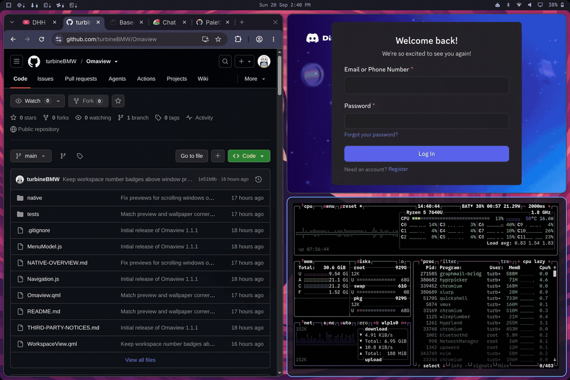
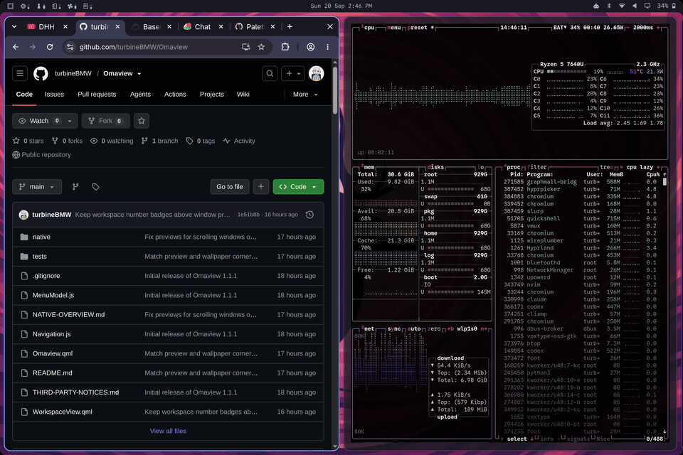
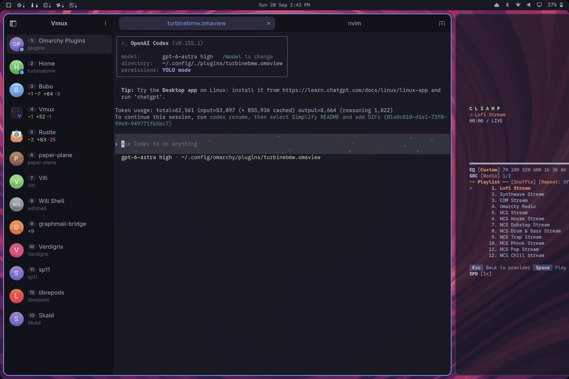

# Omaview

A fullscreen overview for Omarchy: live workspaces, an app launcher, Omarchy
menus, and a dock. Inspired by niri's overview and GNOME's app grid.



## Install

Requires Omarchy with Quickshell. Tested with **Hyprland 0.56.2**; other
versions haven't been validated.

```bash
omarchy plugin add https://github.com/turbineBMW/Omaview --enable
```

The plugin includes a status bar button styled like the Omarchy menu button.
Left-click it to toggle the overview; right-click it to open a terminal.
Scroll over it to switch workspaces: down for the next one, up for the
previous one. Scrolling past the last occupied workspace gives you an empty
one, the same as in the overview. To
show it beside the Omarchy menu button, add `{ "id": "turbinebmw.omaview" }`
after `{ "id": "omarchy.menu" }` in `bar.layout.left` of
`~/.config/omarchy/shell.json`, or run:

```bash
omarchy plugin enable turbinebmw.omaview --section left --after omarchy.menu
```

### Omarchy menu toggles

Add the entries in [docs/omarchy-menu-entry.jsonc](docs/omarchy-menu-entry.jsonc)
to `~/.config/omarchy/extensions/omarchy-menu.jsonc`. They appear under
**Setup → Plugins** with checkmarks for the bar button and the desktop dock.
They use Omarchy's menu `when`, `checked`, and `action` fields, the native
`omarchy bar set` command, and the plugin's `desktopDock` call. Hiding the
button leaves the overview available through its keyboard shortcut.

To open it with **Super+Space**, replace your existing binding in
`~/.config/hypr/bindings.lua`:

```lua
hl.unbind("SUPER + SPACE")
hl.bind("SUPER + SPACE", function()
  hl.exec_cmd("omarchy-shell shell toggle turbinebmw.omaview '{}'")
end)
```

Run `hyprctl reload`, then `hyprctl configerrors` to check the config.
You can also run the `omarchy-shell` command above directly.

The first open builds and loads a small native Hyprland companion. Standard
Omarchy includes the build dependencies; there's no separate Hyprpm setup.
After an update that changes the companion, restart your Hyprland session.

## Remove

Run `omarchy plugin remove turbinebmw.omaview`, then restart your Hyprland
session to unload the native companion. If you added the Super+Space binding
above, remove that binding and restore your previous one before reloading
Hyprland. The plugin does not modify Hyprland configuration during install.

Omarchy removes the plugin checkout. Your dock pins, hidden-app settings and
options remain in `~/.config/omarchy/omaview-pinned.json`, `omaview-hidden.json`
and `omaview.json` (or under `XDG_CONFIG_HOME`), and compiled companions remain
in `~/.cache/omaview/` (or under `XDG_CACHE_HOME`). You may delete those files
after the session restarts if you no longer need them. Icons you changed stay
in `~/.local/share/applications`; use **Reset icon** before removing the plugin
to restore the originals.

## Workspaces

With Hyprland's scrolling layout, the current workspace sits in the center,
with neighboring workspaces peeking in above and below. Other layouts get a
compact strip of workspace thumbnails.

- Click or tap a window to focus it and close the overview. Middle-click closes it.
- Click a workspace to switch to it without leaving the overview.
- On a touchscreen, swipe with one finger over the workspaces. In the scrolling
  layout, swipe up/down to switch workspaces and left/right to scroll through
  windows. In other layouts, swipe left/right to switch workspaces. Longer
  swipes move further.
- Scroll over the workspaces to switch between them. Scrolling sideways moves
  through windows in the scrolling layout. When windows run off the screen, click
  the arrow chips on the edges of the current workspace to scroll to them.
- **Ctrl+Up/Down** switches workspaces. Moving past the last occupied one gives
  you an empty workspace.
- **Ctrl+Left/Right** moves focus between windows using the current layout.

Your usual Hyprland shortcuts still work, so you can move, resize, or rearrange
windows while the overview is open. Previews are live, including windows on
other workspaces.



## Apps, menus, and the dock

Type to search apps and Omarchy menu entries together. Use the arrow keys and
**Enter** to choose one. Your Omarchy menu extensions show up here too.
**Esc** clears the search, backs out of a menu, then closes the overview.



Right-click an app in the launcher to open a menu with **Pin to dock** (or
**Unpin from dock**), **Hide app** and **Change icon…**. The **Hidden** tile at
the end of the grid opens your hidden apps; right-click one and choose
**Unhide app** to restore it. Hidden apps stay out of the main grid and normal
search. Hiding an app leaves its dock pin and running windows alone.

The dock holds pinned apps followed by anything else that's running.

- **Click** to launch an app or focus its windows; click again to cycle through them.
- **Middle-click** to open a new instance.
- **Right-click** to open a menu with **Pin to dock** or **Unpin from dock** and
  **Change icon…**. Right-click the dock's padding to show or hide the dock on
  the desktop.
- **Drag** pinned icons to reorder them. Press Esc or drop outside the pinned
  section to cancel.
- **Scroll** over the dock to switch workspaces.
- Hold **Ctrl** to show letter shortcuts, then press **Ctrl+A**, **Ctrl+B**, etc.
  to switch to that app and close the overview.

Pins are saved in `~/.config/omarchy/omaview-pinned.json`
(or under `XDG_CONFIG_HOME` if set). Hidden apps are saved alongside pins in
`omaview-hidden.json`. Context menus support arrow keys and Enter; Esc or a
click outside dismisses them.



### Changing an app's icon

**Change icon…** turns the grid into an icon picker for that app. With no
search text it shows the icons of your installed apps; type to search the
installed icon themes by name, or type or paste (**Ctrl+V**, or
**Shift+Insert**) the path of an image file. Pick a tile to apply it. The
app's current icon carries a dot.

The icon is stored as a user-local desktop entry in
`~/.local/share/applications` (or under `XDG_DATA_HOME`). An app whose entry
lives in `/usr/share/applications` or another system directory is cloned there
first, keeping its id, and only its `Icon=` line is changed. The original icon
is kept in the entry as `X-Omaview-Icon-Original`, so **Reset icon** in the
same menu restores it, and removes the clone again when nothing else differs
from the system entry. Other launchers that read desktop entries pick up the
change too.

### Dock on the desktop

The dock can also stay on the desktop while the overview is closed: a smaller
copy at the bottom of every screen, above the windows and reserving its own
height. It launches, focuses and cycles apps, shows running dots and tooltips,
reorders pins by dragging, switches workspaces on scroll, and has the same
right-click menu. Opening the overview grows the overview's dock out of it.

It is off by default. Right-click the dock's padding and choose **Show dock on
desktop**, add the menu entry above, or run:

```bash
omarchy-shell shell call turbinebmw.omaview desktopDock on    # on, off, toggle, or '' to query
```

The choice is saved as `{"desktopDock": true}` in `~/.config/omarchy/omaview.json`
(or under `XDG_CONFIG_HOME`). Hyprland draws fullscreen windows over it.

The same file holds the dock's look. Edits apply live, and each key can also be
read or set with `omarchy-shell shell call turbinebmw.omaview setting 'key=value'`
(a bare key reads it). Right-clicking the desktop dock's padding offers the
border, background, icon size, spacing and padding too.

| Key | Default | Meaning |
| --- | --- | --- |
| `desktopDockMargin` | `14` | Gap between the desktop dock and the screen edge, in style units |
| `desktopDockIconSize` | `35` | Icon size on the desktop, in style units (the overview uses 44); the overview dock scales up from it |
| `desktopDockBorder` | `true` | Outline around the desktop dock |
| `dockBackground` | `"theme"` | Color behind both docks: `"theme"` uses the theme's `[omaview]` `dock-background` (below) and falls back to the bar's color, `"bar"` always uses the bar's, `"app"` the theme's base app background |
| `dockOpacity` | `0.85` | Opacity of that color, 0 to 1 |
| `dockSpacing` | `6` | Gap between icons, in style units |
| `dockPadding` | `10` | Space between the icons and the dock's edge, in style units; the top and bottom get 60% of it |

Spacing and padding are set at the overview's size and shared by both docks,
so the desktop dock shows them scaled by its icon size and the overview's dock
still grows out of it exactly.

Style units follow the shell's spacing scale, like the rest of Omaview.

### Theme colors for the dock

A theme can color the dock itself. Add `shell.omaview.toml` to the theme
directory (`~/.config/omarchy/themes/<name>/`) with an `[omaview]` section;
`omarchy theme set` folds it into the theme's shell values, so it applies when
the theme is (re)applied. The same section in `~/.config/omarchy/shell.toml`
overrides every theme live.

```toml
[omaview]
dock-background       = "#21222c"   # hex, a palette role (background, foreground, accent, muted, urgent), or another shell.toml key
dock-background-alpha = 0.9
dock-border           = "accent"
dock-border-alpha     = 0.3
# Optional: the desktop copy only; each falls back to the dock-* key above.
desktop-dock-background       = "background"
desktop-dock-background-alpha = 1.0
desktop-dock-border           = "foreground"
desktop-dock-border-alpha     = 0.18
```

### Glass blur behind the desktop dock

Hyprland can blur what sits behind the desktop dock, like Omarchy's Glassy
bar. Copy [docs/omaview-blur.lua](docs/omaview-blur.lua) to
`~/.config/hypr/omaview-blur.lua`, add `require("hypr.omaview-blur")` to
`~/.config/hypr/hyprland.lua`, and run `hyprctl reload`. The rule matches the
dock's layer namespace `omarchy-omaview-dock` and blurs only the dock's own
pixels, so lower `dockOpacity` or a theme's `dock-background-alpha` to let the
blur show through. The plugin does not change Hyprland configuration itself.

The background keys apply while `dockBackground` in `omaview.json` is
`"theme"` (the default); `"bar"` and `"app"` ignore them and use `dockOpacity`.
The border keys always apply. The desktop dock's right-click menu cycles
**Background: theme / bar / app**.

## Options

Pass a JSON payload to the toggle command to choose a layout or open a submenu:

```bash
omarchy-shell shell toggle turbinebmw.omaview '{"layout":"strip"}'
omarchy-shell shell toggle turbinebmw.omaview '{"menu":"setup"}'
```

`layout` accepts `scrolling` or `strip`. Leave it out to follow the current
workspace's layout. `menu` accepts an Omarchy menu ID or alias.

See [Developing Omaview](DEVELOPING.md) for build requirements, integration
checks, and reload notes, or [Native overview](NATIVE-OVERVIEW.md) for the
architecture.

## Credits

Thanks to [rosakodu](https://github.com/rosakodu) for
[Omarchy Dock](https://github.com/rosakodu/omarchy-dock) and their work on a
native dock for Omarchy.

Omaview is released under the [MIT license](LICENSE). It also uses Omarchy's
menu model; see [Third-party notices](THIRD-PARTY-NOTICES.md) for acknowledgments
and the licenses of reused components.
